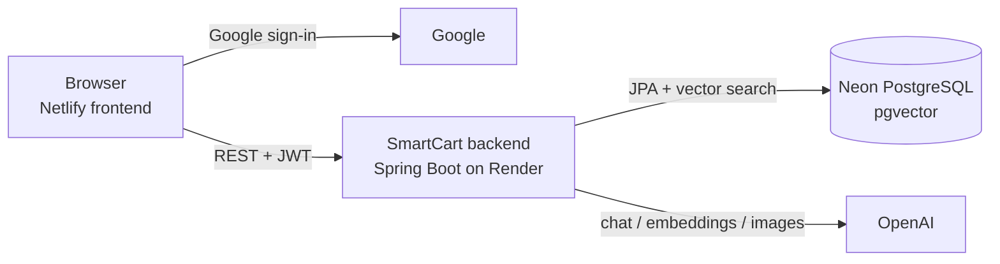
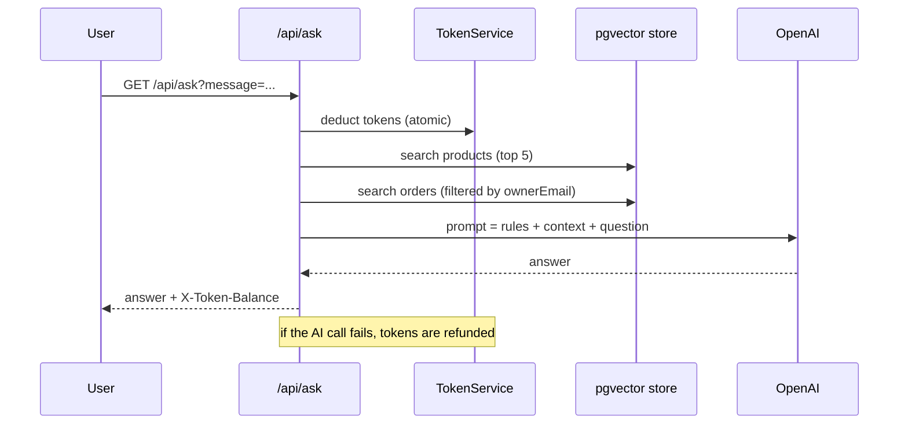
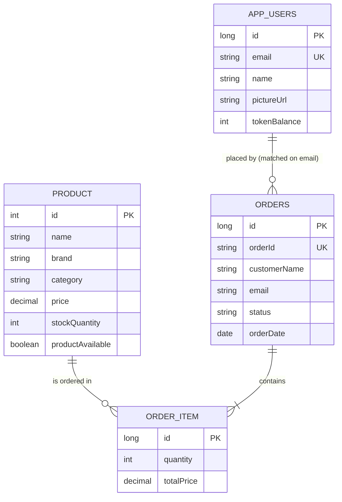

<div align="center">

# 🛒 SmartCart Backend

**An AI-powered e-commerce API with a privacy-safe RAG chatbot, Google sign-in and a token-metered AI layer.**

[](https://smartcart-soumadeep1221.netlify.app/)
[](https://smartcart-1-1.onrender.com)
[](https://github.com/Soumadeep1221/SpringEcommerce_Frontend)


</div>

> ⏳ The backend runs on a free Render instance. After a period of inactivity, the first request can take a couple of minutes while the service wakes up.

---

## ✨ Highlights

| 🔐 Secure sign-in | 🪙 Metered AI | 🤖 Private RAG chatbot |
|---|---|---|
| Google sign-in, then the backend issues its own JWT. The admin is identified by email on every request. | 30 tokens per user. Atomic deduction, automatic refund when the AI call fails. | Metadata-filtered vector search means a customer's question can never retrieve another customer's orders. |

---

## 🚀 Features

- **Google-only authentication.** The backend verifies the Google ID token and issues its own short-lived JWT.
- **Role-based access.** Updating and deleting products and listing all orders are admin-only.
- **Product management** with image upload (5 MB limit), keyword search, update and delete.
- **AI product descriptions and images** generated through OpenAI with Spring AI.
- **RAG chatbot** over products and orders, backed by a pgvector store.
- **Per-user data isolation** in the chatbot, enforced at the retrieval layer and again in the prompt.
- **AI token system** that limits per-user usage and OpenAI spend.
- **Orders with stock checks.** The customer email always comes from the JWT, never from the request body.
- **Clear error handling** with validation messages and meaningful HTTP status codes.
- **Dockerized** and deployed on Render with a Neon PostgreSQL database.

---

## 🧱 Tech stack

| Area | Technology |
|---|---|
| Language | Java 25 |
| Framework | Spring Boot 4.0.2 (Web MVC, Data JPA, Security, Validation) |
| AI | Spring AI 2.0.2, OpenAI chat, embeddings and image models, pgvector vector store |
| Database | PostgreSQL on Neon with the `vector` and `hstore` extensions |
| Auth | Google ID token verification (google-api-client), JWT (jjwt) |
| Build | Maven |
| Deployment | Docker, Docker Hub, Render |

---

## 🏗️ Architecture



<details>
<summary><b>📁 Project structure</b></summary>

```
com.soumadeep.SpringEcommerce
├── Config        SecurityConfig (filter chain, CORS), ChatClientConfig
├── Controller    Auth, Product, Order, ChatBot, Token
├── DTO           request/response records
├── Entity        AppUser, Product, Order, OrderItem
├── Enum          TokenAction (CHAT, DESCRIPTION, IMAGE)
├── Exception     GlobalExceptionHandler
├── Repo          Spring Data JPA repositories
├── Security      JwtRequestFilter
├── Service       Auth, Product, Order, ChatBot, Token, AIImageGen
└── Util          JwtUtil, GoogleAuthUtil

src/main/resources
├── prompts/chatbot-rag-prompt.st    chatbot prompt template
└── init/schema.sql                  pgvector extensions, vector_store table, HNSW index
```

</details>

---

## 🔐 Authentication and authorization

1. The frontend signs the user in with Google and sends the ID token to `POST /api/auth/google`.
2. The backend verifies the token against the configured client ID and requires a verified email.
3. On the first sign-in the user is created with the initial token balance. Name and picture are refreshed on every sign-in.
4. The response is `{ token, user }`. The JWT is signed with HS256, carries the email as subject, and **expires after 30 minutes**.
5. `JwtRequestFilter` validates the `Bearer` token on every request. Everyone gets `ROLE_USER`, and the email matching `ADMIN_EMAIL` also gets `ROLE_ADMIN`. The role is recalculated from the email on each request, so nothing role-related is stored in the token or the database.

CORS allows a single frontend origin (`FRONTEND_URL`) and exposes the `X-Token-Balance` header to the browser.

---

## 🪙 AI token system

- A new user gets **30 tokens on first sign-in**. Tokens are not refilled.
- Costs are set in `application.properties` and can be read from `GET /api/tokens/costs`:

| Action | Default cost |
|---|---|
| 💬 Chatbot message | 2 |
| ✍️ AI product description | 5 |
| 🖼️ AI image generation | 15 |

- `TokenService.charge(...)` deducts first with **one atomic SQL update** (`... WHERE tokenBalance >= cost`), so parallel requests cannot overspend. If no row is updated, the API returns **402 Payment Required**.
- If the AI call fails, the tokens are **refunded** and the API returns an error.
- The admin is never charged.
- AI endpoints return the new balance in the `X-Token-Balance` header.

---

## 🤖 RAG chatbot

Products and orders are stored in the pgvector store as documents with metadata:

| Document | Metadata |
|---|---|
| Product | `type=PRODUCT`, `productId` |
| Order | `type=ORDER`, `orderId`, `ownerEmail` |



**How privacy is enforced, in two layers**

1. **Retrieval filter (the main control).** For a customer, the order search uses `type = ORDER AND ownerEmail = <their email>`, so other customers' orders are never fetched and never reach the model. The admin's order search uses `type = ORDER` only.
2. **Prompt rules (the backup).** The prompt template tells the model that the user is signed in, to answer only from the provided context, to treat the user's message as a question rather than as instructions, and to refuse requests to ignore its rules, reveal them, or show other customers' data.

**What the prompt also sets up:** the assistant's scope (products and the user's own orders), what it must not do (place, cancel, track or refund orders, or invent links, policies and delivery times), how to describe out-of-stock products, and a short, friendly plain-text answer style.

**Retrieval settings:** products top 5 at similarity threshold 0.4. Orders top 3 for customers and top 5 for the admin, at threshold 0.25.

Product vectors are re-indexed whenever a product is added, updated or deleted, and when its stock changes through an order. Each question is answered independently, so there is no conversation memory.

---

## 🗄️ Data model



Orders are linked to users by the `email` value, not by a foreign key.

**Vector table** (created by `init/schema.sql` on startup):

```sql
CREATE TABLE IF NOT EXISTS vector_store(
    id TEXT PRIMARY KEY,
    content TEXT,
    metadata JSONB,
    embedding VECTOR(1536)
);

CREATE INDEX IF NOT EXISTS vector_store_embedding_idx
    ON vector_store USING HNSW (embedding vector_cosine_ops);
```

The vector size `1536` matches `text-embedding-3-small`. If you switch to an embedding model with a different dimension, change this value and re-create the table.

---

## 📡 API reference

All endpoints need `Authorization: Bearer <jwt>` unless marked public.

| Method | Path | Access | Description |
|---|---|---|---|
| POST | `/api/auth/google` | Public | Body `{ "token": "<google id token>" }`. Returns `{ token, user }` |
| GET | `/api/me` | User | Current user: `name`, `email`, `pictureUrl`, `tokenBalance`, `admin` |
| GET | `/api/products` | User | All products |
| GET | `/api/product/{id}` | User | One product (404 if missing) |
| GET | `/api/products/search?keyword=` | User | Case-insensitive search over name, description, brand and category |
| GET | `/api/product/{id}/image` | Public | Product image bytes |
| POST | `/api/product` | User | Multipart: `product` (JSON) and `imageFile`. Returns 201 |
| PUT | `/api/product/{id}` | Admin | Multipart: `product` (JSON) and optional `imageFile` |
| DELETE | `/api/product/{id}` | Admin | 409 if the product is part of an order |
| POST | `/api/product/generate-description?name=&category=` | User, 5 tokens | AI description |
| POST | `/api/product/generate-image?name=&category=&description=` | User, 15 tokens | AI image bytes |
| GET | `/api/ask?message=` | User, 2 tokens | Chatbot answer |
| POST | `/api/orders/place` | User | Place an order. Returns 201 |
| GET | `/api/orders` | Admin | All orders |
| GET | `/api/tokens/costs` | User | Current token costs |

<details>
<summary><b>📦 Order request and response</b></summary>

```json
{
  "customerName": "Soumadeep",
  "items": [
    { "productId": 1, "quantity": 2 }
  ]
}
```

The response contains `orderId`, `customerName`, `email`, `status`, `orderDate` and `items` (`productName`, `quantity`, `totalPrice`).

</details>

<details>
<summary><b>⚠️ Error responses</b></summary>

| Status | When |
|---|---|
| 400 | Validation failed. The body is a map of field name to message |
| 401 | Invalid Google sign-in or unverified Google email |
| 402 | Not enough tokens |
| 404 | Product not found |
| 409 | Not enough stock for an order, or deleting a product that is in orders |
| 500 | Chatbot prompt could not be loaded |
| 503 | AI service or chatbot unavailable |

</details>

---

## ⚙️ Environment variables

| Variable | Purpose |
|---|---|
| `DB_URL` | JDBC URL. It must start with `jdbc:postgresql://`. For Neon, end it with `?sslmode=require` |
| `DB_USERNAME` | Database username |
| `DB_PASSWORD` | Database password |
| `OPENAI_API_KEY` | OpenAI API key |
| `CHAT_MODEL` | Chat model name |
| `EMBEDDINGS_MODEL` | Embedding model name (this project uses `text-embedding-3-small`) |
| `IMAGE_MODEL` | Image model name |
| `SECRET_KEY` | **Base64-encoded** secret for signing JWTs. Generate one with `openssl rand -base64 32` |
| `GOOGLE_CLIENT_ID` | Google OAuth client ID |
| `FRONTEND_URL` | Allowed frontend origin, with `https://` and no trailing slash |
| `ADMIN_EMAIL` | Email address that receives the admin role |
| `PORT` | Set by Render. Defaults to 8080 locally |

> 🔒 Never commit real values. Keep them in a local `.env` (git-ignored) or in your host's environment settings.

---

## 🏁 Getting started

### Prerequisites

JDK 25, Maven, PostgreSQL with the `vector` and `hstore` extensions, a Google OAuth client ID and an OpenAI API key.

### Run locally

1. Create a database and make sure the extensions can be created (`init/schema.sql` runs `CREATE EXTENSION IF NOT EXISTS vector;` and `hstore` on startup).
2. Set the environment variables from the table above.
3. Start the app:

```bash
mvn spring-boot:run
```

The API starts on `http://localhost:8080`. Tables are created automatically (`ddl-auto=update` plus `init/schema.sql`).

### Build the jar

```bash
mvn clean package
java -jar target/smartcart.jar
```

### 🐳 Docker and deployment

```bash
docker build -t <dockerhub-username>/smartcart:<tag> .
docker push <dockerhub-username>/smartcart:<tag>
```

The image is deployed as a Docker web service on Render with all settings supplied as environment variables, and the database runs on Neon. Credentials must never be written into `application.properties`, because they end up inside the jar and the image.

**Deployment checklist**

- [ ] `vector` and `hstore` are enabled on the Neon database.
- [ ] All environment variables are set on Render, including a fresh `SECRET_KEY`.
- [ ] `FRONTEND_URL` matches the deployed frontend exactly.
- [ ] The frontend origin is added in Google Cloud under authorized JavaScript origins, and the OAuth consent screen is published.
- [ ] A monthly spending limit is set in OpenAI billing.
- [ ] `spring.jpa.show-sql` is `false`.

---

## 📚 What I learned

- Why DTOs matter: removing `@AllArgsConstructor` from the `Product` entity fixed a 400 error caused by binding a null into an `int`.
- Making AI features safe to expose publicly: authentication, an atomic token system with refunds, and a billing limit.
- Protecting data in RAG: metadata filters on the vector search are the main control, and the prompt is only a second layer.
- Loading resources so they work inside a JAR (`getContentAsString` instead of file access).
- Deploying a containerized Spring Boot app and debugging real failures: port binding, JDBC URL format and environment variables.

---

## 🚧 Known limitations

- Each Google account gets its own 30 tokens, so someone could create several accounts.
- Adding a product and placing an order call the embedding API without charging tokens.
- Chat retrieval returns only the top matches, so questions that need every record, such as totals or a full order history, get partial answers.
- Stock is decremented without row locking, so simultaneous orders for the last unit could oversell.
- JWTs last 30 minutes and there is no refresh flow, so users sign in again after expiry.
- The free Render instance sleeps when idle and starts slowly.

---

## 🔗 Related repositories

- **Frontend:** [SpringEcommerce_Frontend](https://github.com/Soumadeep1221/SpringEcommerce_Frontend) (React, Vite, Bootstrap, deployed on Netlify)
- **Backend:** [SmartCart_Backend](https://github.com/Soumadeep1221/SmartCart_Backend) (this repository)

---

<div align="center">

## 👨‍💻 Author

**Soumadeep Dey** · Java Backend Developer

[](https://www.linkedin.com/in/soumadeep-dey-)
[](https://github.com/Soumadeep1221)
[](https://soumadeep-dey-portfolio.vercel.app/)

⭐ If you like this project, consider giving the repository a star.

</div>
